# 实验看板 · Deep Learning Experiment UI

[真实实验结果归档](public/experiment-results/) · [实验看板数据](data/experiments/)

一个**纯前端**的多模态深度学习实验看板模板。实验跑完后，由智能体把结果按约定的 JSON 格式写进仓库；研究者打开页面，**不看代码和日志**就能知道：

- 这个实验在干嘛、改了哪一环、结论是什么（30 秒看懂）
- 结果怎么样（图表为主：主结果、训练曲线、消融、细分、案例）
- 模型对在哪、错在哪（视频逐帧、时间轴、边界放大、模型输入帧）
- **这对发论文意味着什么**：现象 → 历史上的同构问题 → 可检验的假设 → 论文方向
- **某篇已发表论文的结论可信吗**：数值自洽检查、差距分解、可信度清单、决策与时间盒
- 想自己跑：可折叠的训练命令与超参数，一键复制

> 仓库自带的 17 个实验、所有数字、所有“【虚构示例】”论文和合成视频**均为编造**，仅用于展示模板。数据集名称、指标定义和透镜库中的历史事实是真实的。

## 预览

> 下面的截图来自仓库自带的示例数据，全部图片在 [`docs/preview/`](docs/preview/)。

| 实验总览 | 实验详情：30 秒看懂 |
|---|---|
| 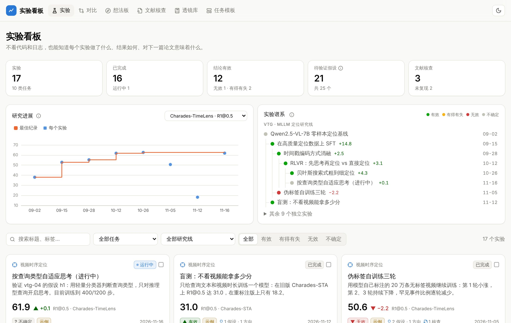 | 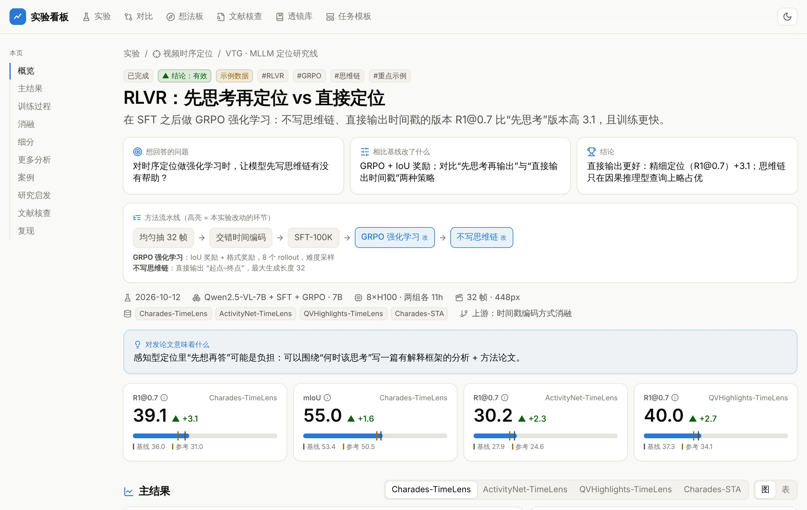 |
| **主结果与训练过程** | **消融（相对默认设置的 Δ）** |
| 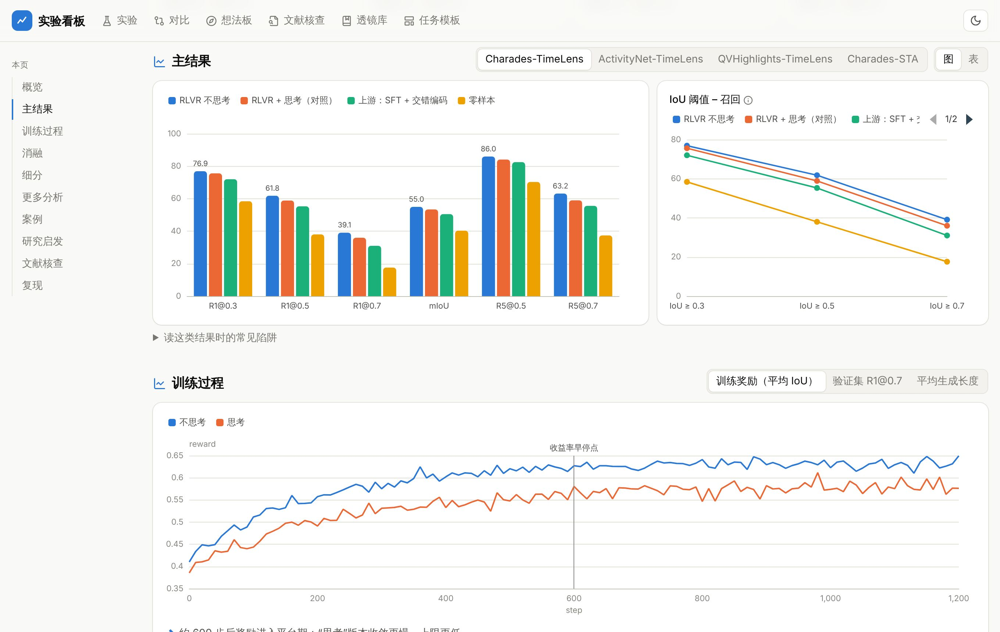 | 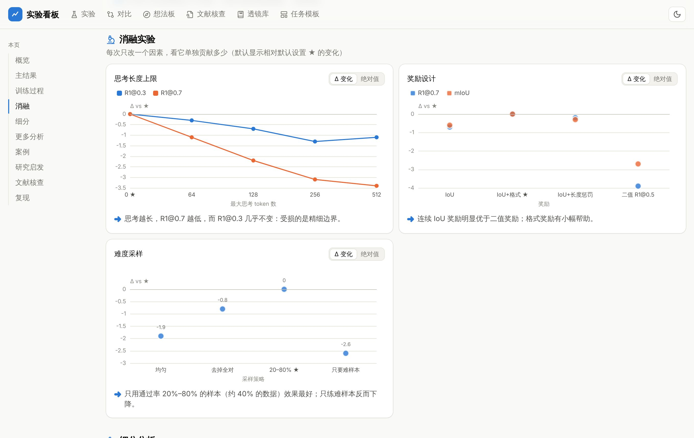 |
| **研究启发：启发链路** | **历史回声：结构映射与可借用的解法** |
| 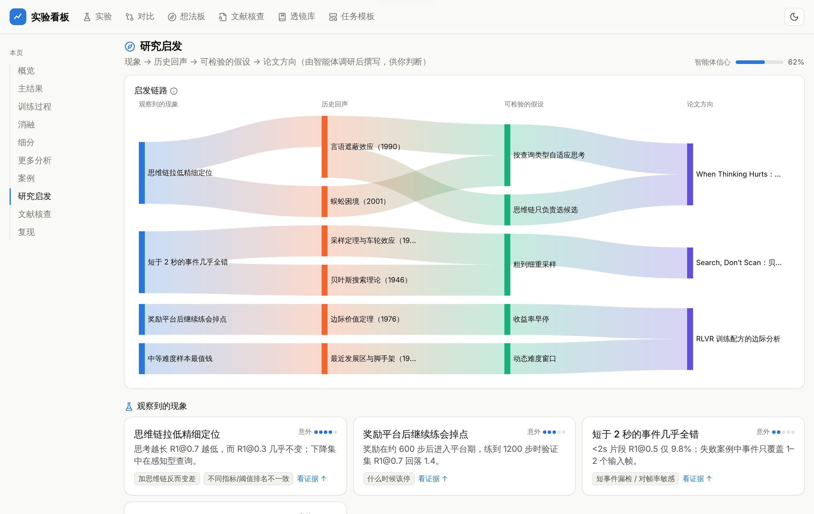 |  |
| **文献核查：差距分解与可信度清单** | **文献核查总览：声称 vs 实测** |
| 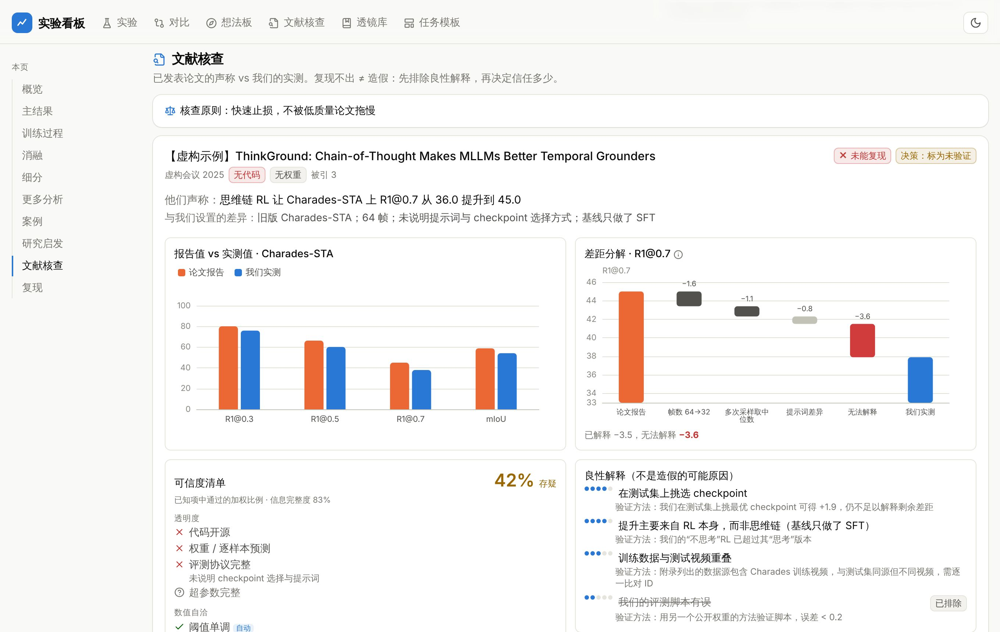 | 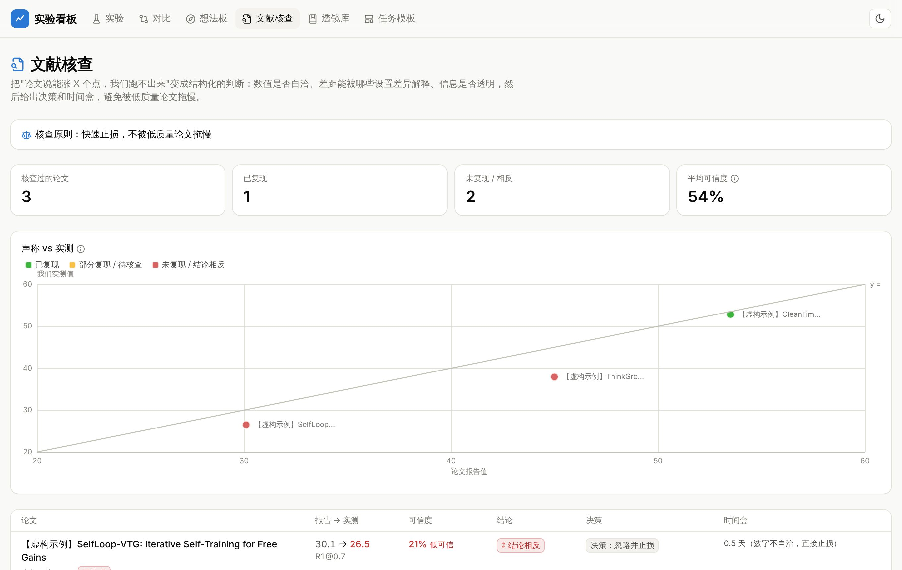 |
| **想法板：假设影响 × 成本** | **透镜库：按现象匹配历史先例** |
| 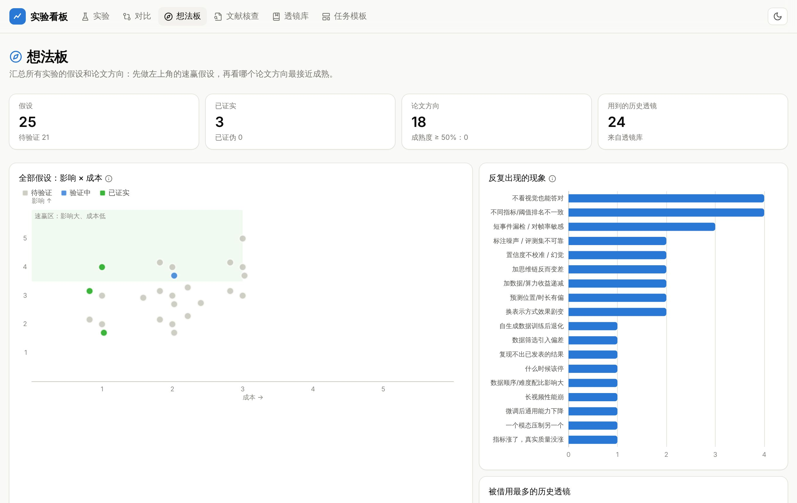 | 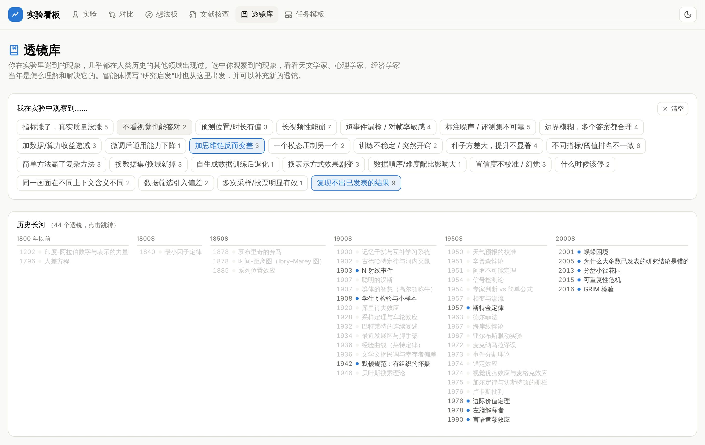 |
| **实验对比** | **任务模板** |
| 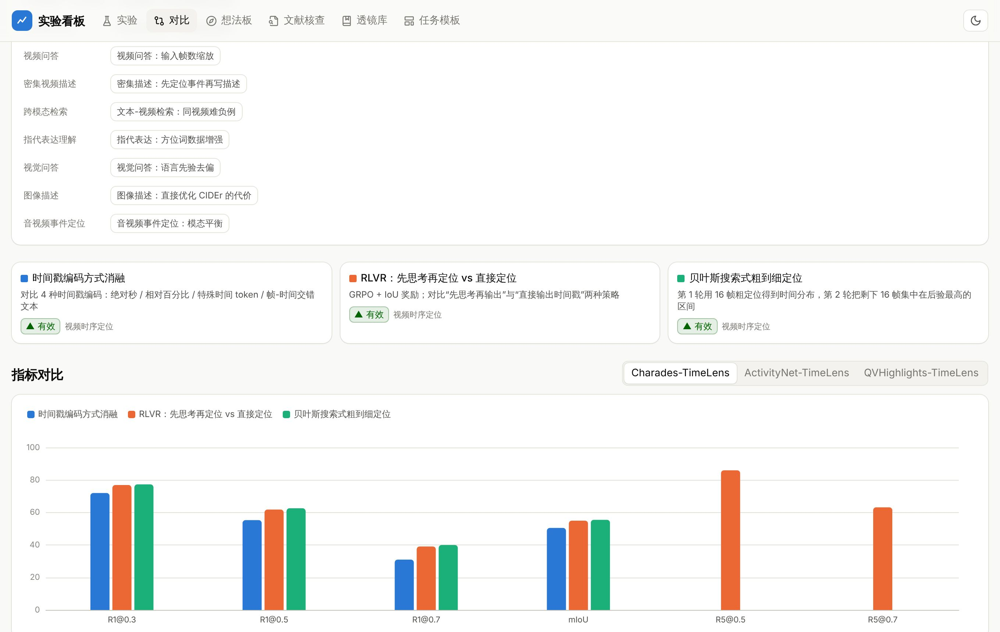 | 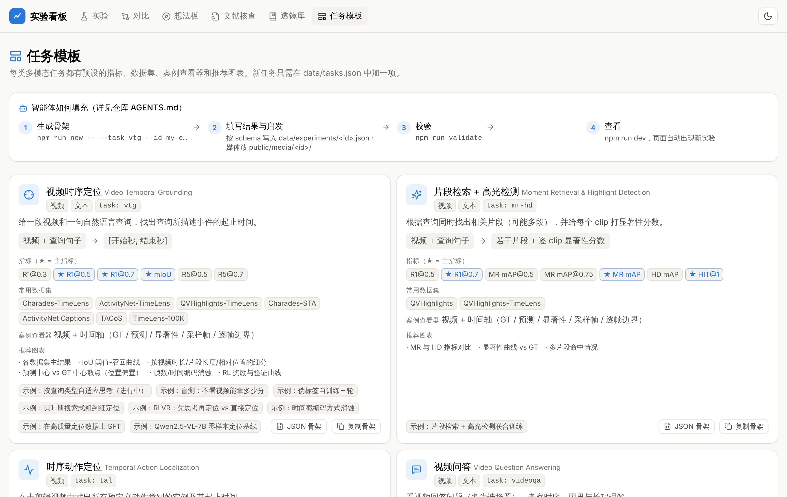 |

**视频定位播放器**：逐帧步进、GT / 预测 / 模型输入帧时间轴、悬停缩略图、边界 ±4 帧

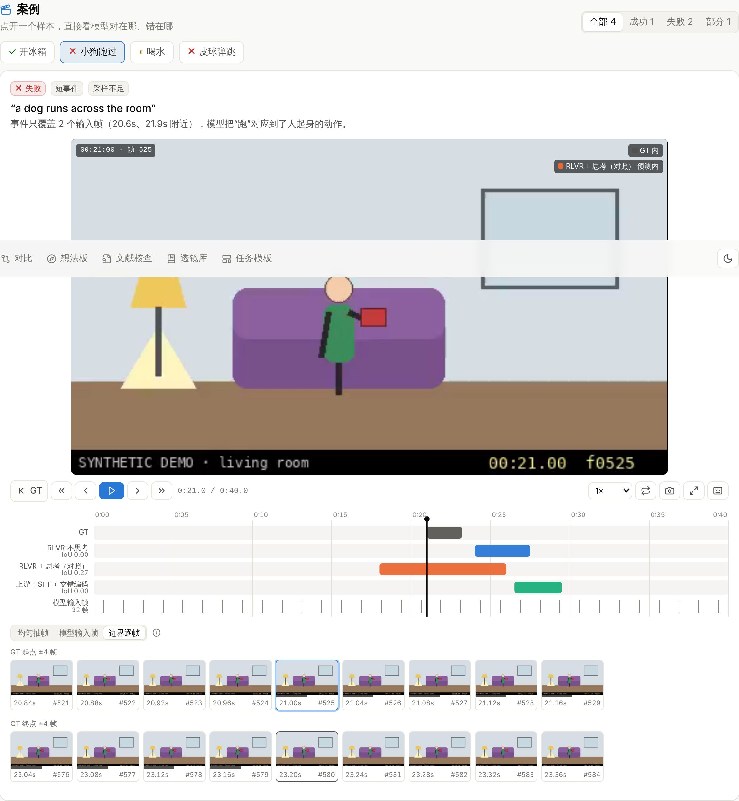

| 暗色模式 | 手机：详情 | 手机：列表 |
|---|---|---|
| 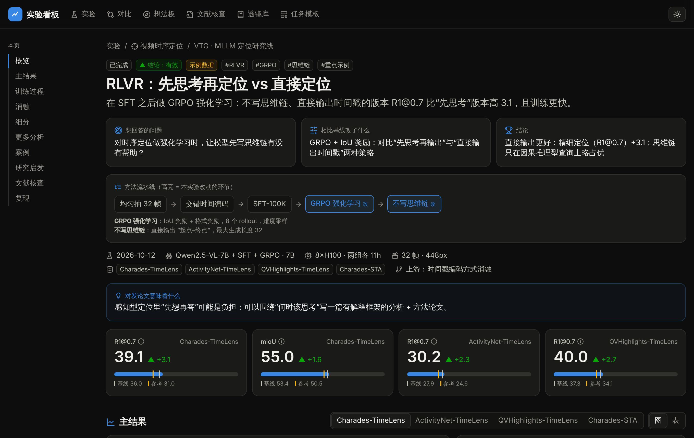 |  | 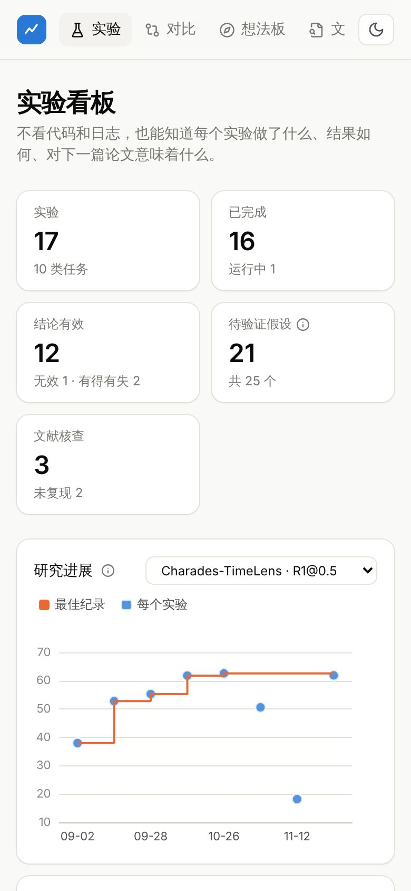 |

---

## 快速开始（本地运行）

需要 Node.js ≥ 18。

```bash
npm install
```

```bash
npm run dev
```

打开终端提示的地址（默认 http://localhost:5173）。智能体新写入的 `data/experiments/*.json` 会自动热更新到页面上。

打包成静态文件后，可以放到任意静态服务器或内网机器上：

```bash
npm run build
```

```bash
npx vite preview --host
```

`npm run build` 会先运行 `npm run validate`，数据有错误时不会打包。产物在 `dist/`，使用 hash 路由和相对路径，放在任何子目录下都能用（例如 `python3 -m http.server -d dist`）。不支持直接双击 `index.html` 打开（浏览器会拦截 `file://` 下的模块脚本）。

---

## 页面导览

| 页面 | 作用 |
|---|---|
| **实验** | 统计卡片、研究进展（最佳纪录阶梯图）、实验谱系树、可筛选的实验卡片；勾选后可对比 |
| **实验详情** | 30 秒看懂（问题 / 改动 / 结论 + 方法流水线）→ 关键指标 → 主结果 → 训练过程 → 消融 → 细分 → 更多分析 → 案例 → 研究启发 → 文献核查 → 复现 |
| **对比** | 最多 6 个实验：指标并排、曲线叠加、超参数差异高亮 |
| **想法板** | 汇总全部假设（影响 × 成本矩阵）、论文方向（按成熟度排序）、反复出现的现象 |
| **文献核查** | 所有核查过的论文：“声称 vs 实测”散点、可信度、结论、决策与时间盒 |
| **透镜库** | 44 个跨学科历史先例：选“我观察到的现象”即可得到匹配透镜；历史长河时间线；思维提示卡（可随机抽卡） |
| **任务模板** | 10 类多模态任务的指标、数据集、案例查看器、推荐图表与 JSON 骨架 |

### 已内置的任务模板

视频时序定位（VTG）、片段检索 + 高光检测、时序动作定位、视频问答、密集视频描述、跨模态检索、指代表达理解、视觉问答、图像描述、音视频事件定位。VTG 的指标与数据集参照 TimeLens（R1@0.3/0.5/0.7、mIoU；Charades-TimeLens、ActivityNet-TimeLens、QVHighlights-TimeLens 等）。

### 视频播放器

- 逐帧步进（←/→）、±1 秒（Shift + ←/→）、0.25×–2× 播放、循环片段、截取当前帧 PNG、全屏
- 时间轴：GT / 各方法预测（Top-k 按置信度淡化）/ 显著性曲线 / 模型实际输入帧；悬停显示缩略图、时间、置信度和 IoU；拖动定位
- 帧条：均匀抽帧 / 模型输入帧 / **边界逐帧**（GT 或所选片段起止点 ±4 帧，用于检查边界标注）
- 视频缺失时自动降级为可交互的时间轴

---

## 智能体如何填充

完整协议见 **[AGENTS.md](AGENTS.md)**（Claude Code 会通过 `CLAUDE.md` 自动读取）。简要流程：

```bash
npm run new -- --task vtg --id vtg-09-my-idea --title "标题" --parent vtg-04-rlvr-thinking
```

然后填写 `data/experiments/vtg-09-my-idea.json`，把媒体放到 `public/media/vtg-09-my-idea/`，再运行：

```bash
npm run validate -- vtg-09-my-idea
```

校验内容包括 JSON Schema、字段拼写、交叉引用、媒体文件，以及 VTG 指标的数值自洽（R1 单调、mIoU 理论上下界）。

### 两个核心设计

**研究启发（insights）**：智能体不只填数字，还要按 7 步协议思考：列出现象 → 到透镜库与各学科中寻找“历史回声”（例如思维链损害精细定位 ↔ 1990 年的言语遮蔽效应；短事件漏检 ↔ 采样定理；何时早停 ↔ 边际价值定理）→ 写出结构映射与可借用的解法 → 提出可证伪的假设和最小实验 → 汇聚成论文方向并查重 → 用提示卡（审稿人 2、反转、TRIZ……）换角度 → 把需要人决定的问题交还给研究者。

**文献核查（claims）**：当我们的结果不支持某篇论文时，不急于下“造假”的结论。先做数值自洽检查（类似心理学中的 GRIM 检验），把差距分解成“已知设置差异”和“无法解释的部分”，逐条排除良性解释，按清单打可信度，最后给出决策（沿用 / 标为未验证 / 忽略 / 联系作者 / 写成负结果）和时间盒，快速止损。

---

## 目录结构

```
├── AGENTS.md                      # 智能体填写协议（研究启发 / 文献核查流程）
├── data/
│   ├── experiments/*.json         # 每个实验一个文件（智能体写这里）
│   ├── tasks.json                 # 任务、指标、数据集注册表
│   ├── lenses.json                # 透镜库：现象类型 + 跨学科历史先例
│   ├── prompts.json               # 思维提示卡（Polya、Heilmeier、TRIZ 等）
│   └── audit.json                 # 文献核查原则、清单、结论与决策
├── schema/experiment.schema.json  # 数据契约（JSON Schema）
├── scripts/
│   ├── validate.mjs               # 校验
│   ├── new-experiment.mjs         # 生成骨架
│   └── gen_sample_media.py        # 生成示例合成视频/图片
├── public/media/                  # 案例视频与图片
└── src/
    ├── lib/                       # 类型、数据加载、配色、格式化、核查算法
    ├── components/
    │   ├── cases/                 # 时序播放器 + 各类案例查看器
    │   ├── experiment/            # 详情页各区块
    │   ├── insights/              # 研究启发
    │   ├── claims/                # 文献核查
    │   └── charts/                # ECharts 封装
    └── pages/                     # 各页面
```

## 扩展

- **新任务 / 指标 / 数据集**：编辑 `data/tasks.json`，不需要改代码。
- **新历史透镜 / 现象类型**：编辑 `data/lenses.json`；**新提示卡**：编辑 `data/prompts.json`。
- **新案例展示方式**：在 `src/lib/types.ts`、`schema/experiment.schema.json`、`src/components/cases/CaseViewer.tsx` 中各加一个分支。
- **替换示例数据**：删除 `data/experiments/` 下的示例文件和 `public/media/samples/` 即可，页面会自动只显示你的实验。

## 技术栈

Vite · React 18 · TypeScript · Tailwind CSS · ECharts · lucide-react · Ajv。图表配色采用经过色盲安全校验的分类色板，并分别为亮色和暗色模式调校。
